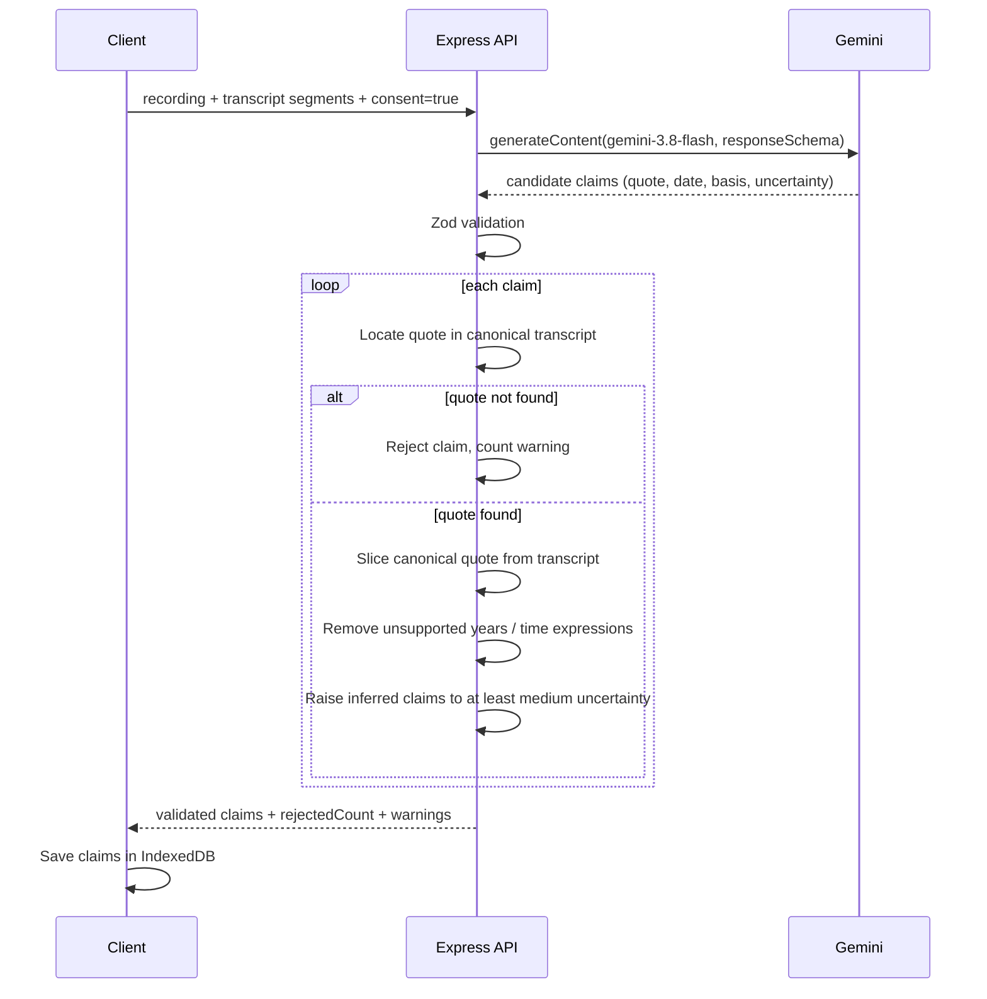
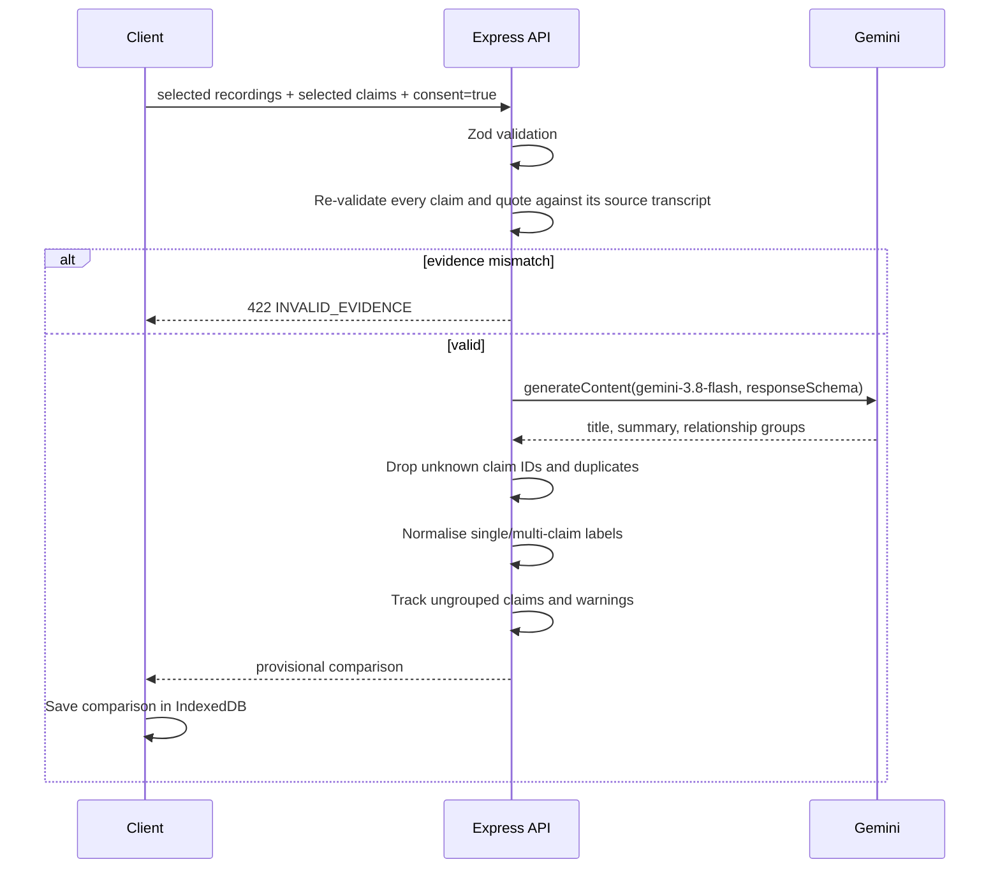

# EchoLedger architecture

EchoLedger is a two-process web application:

1. A **React single-page client** that owns the research archive in the browser.
2. A **stateless Node/Express API** that validates requests and acts as the only holder of the Gemini API key.

There is no application database and no server-side archive. The server never persists recordings, transcripts, claims, comparisons, or researcher notes.

> The built-in demo archive is fictional. Its narrators, claims, and synthetic TTS audio exist to demonstrate the workflow and must not be treated as historical evidence.

---

## System overview

```mermaid
flowchart LR
  subgraph Browser
    UI[React 19 / Vite SPA]
    IDB[(IndexedDB<br/>recordings · audio · claims · comparisons)]
    Consent[Consent dialog]
    Export[JSON · CSV · Markdown]
    UI <--> IDB
    UI --> Consent
    Consent -->|explicit approval| API
    UI --> Export
  end

  subgraph Server["Node / Express"]
    Routes[AI routes]
    Zod[Zod request validation]
    Evidence[Quote and date validation]
    Prompts[Evidence-first prompts]
    GeminiClient[@google/genai]
    Temp[(OS temp uploads<br/>deleted after request)]
    Routes --> Zod --> Evidence --> Prompts --> GeminiClient
    Routes --> Temp
  end

  subgraph Google["Google Gemini"]
    Transcribe[Gemini 3.5 Transcribe]
    Text[Gemini 3.8 Flash]
  end

  API[HTTPS JSON / multipart] --> Routes
  GeminiClient --> Transcribe
  GeminiClient --> Text
```

### Trust boundaries

| Boundary | What crosses it | Controls |
| --- | --- | --- |
| Browser → API | Audio file or transcript/claim JSON | Explicit consent, client-side limits, server Zod validation, rate limiting |
| API → Gemini | Only the material needed for the chosen operation | Server-only key, selected records only, prompts forbid external knowledge |
| Gemini → API | Transcript, structured claims, structured comparison | Schema validation, quote location, date checks, claim-ID checks |
| API → Browser | Validated result, warnings, model metadata | No key exposure, stable error mapping |
| Browser → disk | Archive data and audio blobs | IndexedDB; no automatic sync or upload |

The only exception to "local first" is the operation the researcher explicitly approves. That operation is always named in the consent dialog, and the dialog lists the material being sent.

---

## Client architecture

### Routes

| Route | Page | Responsibility |
| --- | --- | --- |
| `/` | Dashboard | Archive summary, recent material, demo entry point, AI status |
| `/recordings/new` | Add recording | Audio upload or transcript-only intake, optional consented transcription/extraction |
| `/library` | Archive | Search, filters, sorting, export |
| `/recordings/:id` | Recording detail | Audio, transcript editing, claim extraction, metadata, deletion |
| `/claims` | Claim explorer | Ledger-wide search/filter/export |
| `/claims/:id` | Claim detail | Evidence, context, audio excerpt, researcher review |
| `/compare` | Compare accounts | Recording/claim selection and consented comparison |
| `/comparisons/:id` | Comparison detail | Provisional relationship groups and exports |
| `/map` | Research map | Timeline, themes, relationships |
| `/settings` | Settings & AI | AI status, storage, demo controls, destructive actions |

### State

- `ArchiveContext` loads recordings, claims, and comparisons from IndexedDB, exposes mutations, and keeps the UI in sync.
- `ToastContext` provides transient success/error feedback.
- Page-local state handles forms, filters, playback, and dialogs.
- No global state library is needed at this scale.

### IndexedDB schema

Database: `echoledger` (version 1)

| Store | Key | Indexes | Contents |
| --- | --- | --- | --- |
| `recordings` | `id` | `by-createdAt`, `by-language`, `by-place`, `by-speaker` | Metadata, transcript segments, audio metadata, demo flag, consent timestamp |
| `audio` | `recordingId` | — | Original audio `Blob`, MIME type, file name |
| `claims` | `id` | `by-recording`, `by-createdAt` | Claim text, entities, time period, evidence, uncertainty, review notes |
| `comparisons` | `id` | `by-createdAt` | Provisional groups, ungrouped claims, model metadata, warnings |

Audio blobs are stored separately from recording metadata so the library can load quickly. Deleting a recording removes its audio and claims and prunes affected comparison groups in a single transaction.

### Offline behaviour

The client shell and archive are usable without a network connection. Live AI calls and the initial static assets require the server. There is no service worker or offline cache in this MVP.

---

## Server architecture

### Modules

| File | Role |
| --- | --- |
| `server/src/index.ts` | Express app, security middleware, static SPA serving, error handler, shutdown cleanup |
| `server/src/config.ts` | Environment parsing and non-sensitive AI status |
| `server/src/routes/ai.ts` | Upload handling, consent checks, request validation, temp-file cleanup |
| `server/src/schemas.ts` | Zod schemas for API input and model output |
| `server/src/gemini.ts` | Files API upload, transcription, claim extraction, comparison |
| `server/src/prompts.ts` | Evidence-first prompts and transcript serialisation |
| `server/src/transcript.ts` | Quote location, plain-text segmentation, timestamp parsing |
| `server/src/errors.ts` | Stable API errors and provider error mapping |

### Security middleware

- `helmet` with a cross-origin resource policy suitable for local audio playback. CSP is disabled because Vite/React output is served directly in this MVP; add a production CSP before a public deployment.
- CORS allow-list from `CLIENT_ORIGIN`, plus same-origin requests and localhost in development.
- `express.json({ limit: "12mb" })` for transcripts and comparisons.
- `express-rate-limit` on `/api/ai`: 40 requests per 15 minutes per client.
- Upload validation: one file, audio extension allow-list, size cap, optional duration check via `music-metadata`.
- Temporary uploads live under the OS temp directory and are deleted after every request, including validation failures. The directory is cleared at startup and shutdown.

### Error model

API errors use a stable shape:

```json
{
  "error": {
    "code": "INVALID_EVIDENCE",
    "message": "Human-readable explanation."
  }
}
```

Provider messages are logged server-side only. The browser receives mapped codes such as `AI_NOT_CONFIGURED`, `AI_AUTH_FAILED`, `RATE_LIMITED`, `MODEL_UNAVAILABLE`, `AI_TIMEOUT`, and `INVALID_MODEL_OUTPUT`.

---

## AI workflows

### 1. Audio transcription

```mermaid
sequenceDiagram
  participant R as Researcher
  participant C as Client
  participant S as Express API
  participant G as Gemini
  R->>C: Choose audio + language
  C->>R: Consent dialog (material, provider, limits)
  R->>C: Confirm
  C->>S: multipart audio + consent=true + languageCode
  S->>S: Validate type, size, duration; write temp file
  S->>G: Files API upload
  G-->>S: file URI
  S->>G: generateContent(gemini-3.5-transcribe, VERBATIM, wordTimestamp)
  G-->>S: audioTranscription parts + word offsets
  S->>S: Group words into segments; keep only verified timestamps
  S-->>C: transcript, segments, language, duration, warnings
  S->>S: Delete temp upload and remote Gemini file
  C->>C: Store recording + audio blob in IndexedDB
```

Key details:

- The default model is `gemini-3.5-transcribe`, configurable with `GEMINI_TRANSCRIBE_MODEL`.
- `audioTranscriptionConfig` requests `VERBATIM` mode, word timestamps, and an optional BCP-47 language hint.
- Word offsets such as `1.250s` are parsed into seconds. Segments are built from speaker changes, gaps over 1.6 seconds, sentence endings, or length limits.
- If the model returns no word annotations, the server falls back to plain-text segmentation and sets `timestampSource: "none"`. The UI warns that no playback positions are verified.
- Gemini remote files are deleted in a `finally` block.
- The 30-minute cap reflects Gemini's word-timestamp limit.

### 2. Claim extraction



The quote locator:

- Tries an exact substring first.
- Falls back to case-insensitive, whitespace-normalised matching.
- Returns the canonical transcript slice, never the model's version.
- Computes evidence timestamps only when every overlapping segment has consistent start/end times.
- Records `segmentId` and all overlapping `segmentIds` for traceability.

Date handling:

- `timePeriod.start` / `end` are retained only if they contain a four-digit year that also appears inside the supporting quote.
- Relative expressions are retained only if they appear verbatim in the quote.
- Missing or unsupported values become `null` with a warning; they are never estimated.

### 3. Cross-account comparison



Relationship labels are deliberately descriptive:

| Label | Meaning |
| --- | --- |
| `corroborating` | Accounts broadly agree. Agreement is not proof of truth. |
| `conflicting` | Accounts cannot both be true as stated. Conflict is not proof that either is false. |
| `related` | Same subject, not identical, not clearly incompatible. |
| `unique` | Only one account in the selected set makes the claim. |
| `uncertain` | Evidence is insufficient or ambiguous. Missing evidence is not evidence of absence. |

The server does not decide which narrator is correct, and the prompt explicitly forbids external historical knowledge.

---

## Data model

### Recording

```ts
type Recording = {
  id: string;
  title: string;
  speaker: string;
  language: string;
  languageCode: string | null;
  place: string;
  period: string;
  topics: string[];
  notes: string;
  createdAt: string;
  updatedAt: string;
  source: "audio" | "transcript";
  transcriptSource: "gemini" | "manual" | "srt" | "vtt" | "demo";
  transcriptSegments: TranscriptSegment[];
  audio: AudioMeta | null;
  isDemo: boolean;
  consentAt: string | null;
  transcriptEditedAt: string | null;
};
```

A segment stores `text`, optional `translation`, optional `speakerLabel`, and nullable `startSeconds` / `endSeconds`. Null means "not verified", not "zero".

### Claim

```ts
type Claim = {
  id: string;
  recordingId: string;
  claimText: string;              // neutral English normalisation
  claimType: ClaimType;
  entities: Array<{ name: string; type: EntityType }>;
  timePeriod: {
    start: string | null;
    end: string | null;
    originalExpression: string | null;
  };
  evidence: {
    quote: string;                // canonical transcript slice
    startSeconds: number | null;
    endSeconds: number | null;
    timestampSource: "gemini-word" | "segment" | "none";
    segmentId: string | null;
    segmentIds: string[];
  };
  basis: "explicit" | "inferred";
  uncertainty: "low" | "medium" | "high";
  speakerWording: string;
  interpretationNote: string | null;
  evidenceStatus: "valid" | "quote-mismatch";
  researcherNotes: string;
  createdAt: string;
  updatedAt: string;
  isDemo: boolean;
  model: string;
};
```

### Comparison

```ts
type Comparison = {
  id: string;
  title: string;
  summary: string;
  recordingIds: string[];
  groups: ComparisonGroup[];
  ungroupedClaimIds: string[];
  createdAt: string;
  model: string;
  isDemo: boolean;
  disclaimer: string;
  warnings: string[];
};
```

Each group stores a topic, relationship label, evidence-based rationale, claim IDs, and comparison confidence.

---

## Export schema

The archive export uses `echoledger.research.v1`:

- `schemaVersion`, `generator`, `exportedAt`, `disclaimer`
- `containsDemonstrationData`
- `recordings[]` with transcript segments, audio metadata, and nested claims
- `claims[]` nested under their recording, with evidence provenance and relationships
- `comparisons[]` with groups and hydrated claim summaries
- `ungroupedClaimIds`

Audio is intentionally excluded. The JSON records the audio file name, MIME type, size, and duration so an archive can be re-associated with its source media. CSV exports one row per claim and includes a UTF-8 BOM for spreadsheet compatibility. Markdown exports are human-readable and include the demo warning and disclaimer.

---

## Demo data

- `client/src/data/demo.ts` contains the fictional narrators, transcripts, claims, and comparison.
- `client/src/lib/seedDemo.ts` writes the dataset to IndexedDB and fetches the synthetic MP3s from `client/public/demo-audio/`.
- Demo audio was generated with TTS and is not a real oral-history recording.
- Demo records have `isDemo: true`, render a DEMO badge, show a global banner, and are flagged in every export.
- Demo data can be removed from Settings without touching researcher records.

---

## Deployment notes

- The production server serves `client/dist` and the API from one Express process.
- Build with `npm run build`; start with `npm run start`.
- Set `NODE_ENV=production` in production.
- The API key belongs in the server environment, never in client code.
- The server writes temp uploads to the OS temp directory. Ensure the process can write there and that the directory is cleaned on restart.
- There is no server-side database to back up. Researchers must export their archive to preserve it.
- Add a production Content Security Policy before exposing the app publicly. The current MVP disables CSP so the Vite/React bundle can run unchanged.

---

## Verification

Performed in this checkout:

- `npm run typecheck` — server and client pass.
- `npm run build` — server and client compile; production server serves the SPA and demo audio.
- Browser walkthrough with the demo archive:
  - demo seeding and banner
  - dashboard, library, search
  - recording detail, transcript segments, audio metadata
  - claim explorer and claim detail with evidence context
  - research map timeline, themes, relationships
  - saved comparison and relationship groups
  - settings
  - transcript-only record creation and deletion
- No-key behaviour: AI endpoints return `AI_NOT_CONFIGURED`; local workflows remain usable.

Not performed:

- Live Gemini transcription, extraction, or comparison, because no API key was available in the build environment. Run a keyed smoke test before production use.
- Automated browser or unit tests. This MVP intentionally ships without a test suite.
